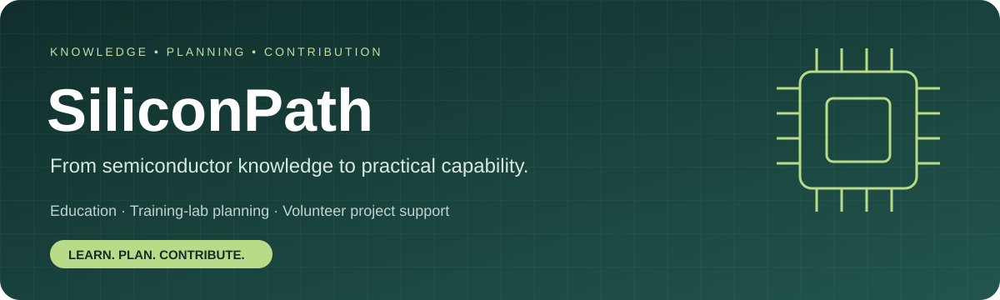

# SiliconPath
**Semiconductor education, training-lab planning & volunteer project support**

[Visit SiliconPath](https://siliconpath-six.vercel.app/) · [About & mission](https://siliconpath-six.vercel.app/#about) · [Services](https://siliconpath-six.vercel.app/#support) · [Project charter](docs/PROJECT_CHARTER.md) · [Contribute](CONTRIBUTING.md)

Created and curated by [Arun Kumar Gharami](https://www.arungharami.info/).

## Mission
Connect credible semiconductor learning with practical planning, digital tools and voluntary project support so learners and project teams can make informed decisions.

## Vision
A pathway from curiosity to capability: more learners and institutions developing semiconductor knowledge, supervised practical skills and well-documented projects.

## What you can use today
- Six guided learning paths and a curated catalog of 32 starting resources.
- Interactive micro, medium and large conceptual lab models.
- Equipment guidance, curriculum mapping and user-entered budget scenarios.
- Operational planning studies, blank documentation templates and downloadable briefs.
- Browser-local study notes, reading lists, workspace export and restore.
- A volunteer services portfolio, inquiry brief and email-draft workflow.

## Services and tangible outputs
| Service | Output |
| --- | --- |
| Project readiness | Scoped brief, requirements register and open questions |
| Facility and workflow support | Concept workflow, space inventory and specialist-review agenda |
| Equipment and supplier research | Comparison matrix, shortlist and quote register |
| Workforce preparation | Training roadmap, activity worksheets and reviewer-approved assessment criteria |
| Setup coordination | Action tracker, decision records and milestone report |
| Digital tools and research | Bounded demonstration, source files, documentation and handover |

Volunteer availability, deliverables, external costs, permissions and reviewers are agreed per engagement. Engineering design, process settings, installation, commissioning and safety approval remain with qualified specialists and the responsible host.

## Project status and evidence
This is a working independent educational platform and a proposed volunteer service initiative. Public commits and source code show what has been implemented; they do not establish accreditation, institutional endorsement or production readiness.

- Functional/content checks and the static build passed during the October 11, 2026 update.
- Tests run in a Node VM; full browser and visual verification remains outstanding.
- Source descriptions summarize listings; full-content and faculty review are pending.
- Detailed Vivo-related warehouse and volunteer project case studies require exact roles, dates, permitted names and supporting evidence.
- The maintainer supplied the GitHub organization name SiliconPath-six. Connector access and organization profile publication remain unverified; see the prepared profile and access guide. A dedicated Hugging Face organization is not verified.

## Local development
Requires Node.js 20 or later. No runtime npm dependencies.

```bash
npm run check
npm test
npm run build
npm run dev
```

The build produces `dist/`. The development server uses http://localhost:5173. Hash routes support static hosting. See the operational notes below for deployment and catalog maintenance.

## Participate
Report a reproducible bug, propose a source correction, improve accessibility, document a simulation or help review a scoped learning activity. Read [CONTRIBUTING.md](CONTRIBUTING.md) before starting.

## Public identity and contact
- Website: https://siliconpath-six.vercel.app/
- Canonical source: https://github.com/Arungharami/SiliconPath
- Maintainer: Arun Kumar Gharami
- Contact: [arun_gharami@live.com](mailto:arun_gharami@live.com)
- Proposed organization setup: [prepared plan and profile copy](docs/ORGANIZATION_SETUP.md)

Independent educational project · Prepared for faculty discussion.
No institutional affiliation, endorsement, accreditation or certification is implied.

Third-party resources retain their owners' rights. Do not infer a reuse license from public repository visibility; a project-wide license has not been selected.


## Maintenance and validation
Edit `resources.json` for catalog changes. Run `npm run check`, `npm test` and `npm run build`. Use `npm run catalog -- list fabrication` to inspect records and `npm run export:catalog` to export the catalog. The development server is http://localhost:5173.

Vercel uses build command `npm run build`, output directory `dist` and the existing SiliconPath project. Notes and progress use browser localStorage. No account system or cloud synchronization is implemented.

See [roadmap](docs/ROADMAP.md), [editorial guide](docs/EDITORIAL_GUIDE.md) and [resource catalog](docs/RESOURCE_CATALOG.md).
